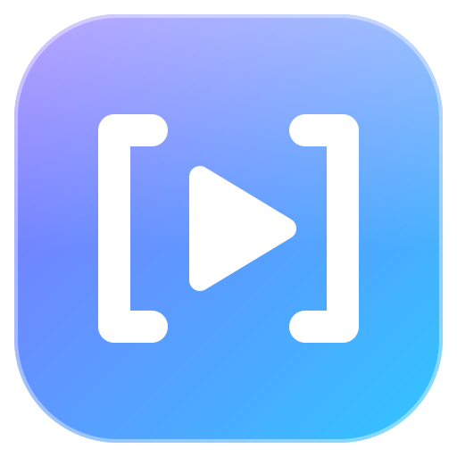

<p align="center"></p>

<h1 align="center">VideoGrab</h1>

<p align="center">Téléchargez une vidéo complète ou <b>juste l'extrait</b> dont votre montage a besoin.<br>
YouTube, TikTok, Instagram, Vimeo, X et plus de 1000 sites · MP4 H.264, MP3 320 kb/s ou WAV · Windows et macOS</p>

<p align="center"><i>Créé par <b>Fulbert Adeniyi</b></i></p>

<p align="center">
  <a href="https://github.com/Fulberitodesign/videograb/releases/latest/download/VideoGrab-Setup.exe"><b>Télécharger pour Windows</b></a> ·
  <a href="https://github.com/Fulberitodesign/videograb/releases/latest">macOS</a> ·
  <a href="https://videograb-fulbert.netlify.app/">Site</a>
</p>

---

## Fonctions

- **Extraits précis** : choisissez le début et la fin sur une timeline, en tapant les temps ou avec les touches `I` / `O`. Seul ce passage est téléchargé, coupé à l'image près.
- **Aperçu avec le son**, lecture de l'extrait en boucle et contrôle du volume.
- **Prêt pour le montage** : MP4 H.264 + AAC (Premiere Pro, DaVinci Resolve, Final Cut, CapCut), de 480p à 4K, avec ou sans le son.
- **Audio** : MP3 320 kb/s constant ou WAV PCM 16 bits, en stéréo.
- **Convertir une vidéo MP4 en MP3 haute qualité** : glissez une vidéo de votre ordinateur dans la fenêtre.
- **Annulation** des téléchargements en cours, sans fichier partiel laissé.
- **Tout est intégré** : yt-dlp et FFmpeg sont inclus, rien d'autre à installer.

## Installation

### Windows 10 / 11
Téléchargez [`VideoGrab-Setup.exe`](https://github.com/Fulberitodesign/videograb/releases/latest/download/VideoGrab-Setup.exe) et double-cliquez dessus. VideoGrab s'installe avec ses raccourcis (Bureau et menu Démarrer).
Si Windows affiche « Windows a protégé votre ordinateur » : **Informations complémentaires → Exécuter quand même**.
Désinstaller : Paramètres → Applications → VideoGrab.

### macOS 11+ (puce Apple ou Intel)
Dans le Terminal :
```bash
curl -fsSL https://raw.githubusercontent.com/Fulberitodesign/videograb/main/setup/install-mac.sh | bash
```
Ou téléchargez le `.dmg` depuis la [dernière version](https://github.com/Fulberitodesign/videograb/releases/latest) (`arm64` = puce Apple, `x64` = Intel), glissez VideoGrab dans Applications, puis la première fois : clic droit → Ouvrir.

## Raccourcis clavier

| Touche | Action |
|---|---|
| `Espace` | Lecture / pause |
| `I` / `O` | Début / fin de l'extrait à la position de lecture |
| `P` | Lire l'extrait en boucle |
| `←` `→` | ±1 s (`Maj` : ±5 s) |
| `,` `.` | Image précédente / suivante |
| `↑` `↓` | Volume |
| `M` | Couper / remettre le son |

## Développement

Application [Electron](https://www.electronjs.org/) : `main.js` (processus principal : téléchargements via yt-dlp, conversions via FFmpeg), `preload.js`, interface dans `ui/`.

```bash
npm install
npm start          # prepare yt-dlp / ffmpeg dans bin/ puis lance l'application
npm run dist:win   # installateur Windows dans dist/
npm run dist:mac   # .dmg macOS (puce Apple)
```

Publier une version : changer `version` dans `package.json`, puis pousser un tag `vX.Y.Z`. GitHub Actions construit les installateurs Windows et macOS et les publie dans une Release.

Le site de présentation se trouve dans `docs/` (https://videograb-fulbert.netlify.app).

## Droits

Ne téléchargez que des contenus que vous avez le droit d'utiliser : vos propres vidéos, des contenus sous licence libre ou avec l'accord de l'auteur. Respectez les conditions d'utilisation des plateformes. VideoGrab n'est affilié à aucune d'entre elles.

## Licence

[MIT](LICENSE) — © 2026 Fulbert Adeniyi
